# Tái hiện ADGR — GraphRAG Y khoa tiếng Việt

**🌐 Ngôn ngữ / Language: [Tiếng Việt](README.vi.md) | [English](README.md)**
**📄 Báo cáo đầy đủ: [report.pdf (EN)](report/report.pdf) | [report_vi.pdf (VI)](report/report_vi.pdf) — 12–13 trang mỗi bản, hình nào cũng có hướng dẫn đọc**
**📝 Nguồn LaTeX (bản Việt là gốc, bản Anh dịch câu-đối-câu): [report.tex](report/report.tex) | [report_vi.tex](report/report_vi.tex)**
**📊 Slide thuyết trình (khái quát): [slides_ADGR.pptx](report/slides_ADGR.pptx)**

Tái hiện độc lập, từ đầu, hệ thống *Adaptive Directed Graph Retrieval*
(paper nộp tạp chí *Applied Intelligence*): trả lời câu hỏi y khoa tiếng Việt
bằng cách tra cứu chứng cứ trong knowledge graph (bệnh, thuốc, triệu chứng và
mối liên hệ). Bản Việt là gốc duy nhất; bản Anh dịch câu-đối-câu từ bản Việt.

Nguyên tắc xuyên suốt: **không đòi số giống hệt khi điều kiện khác nhau —
nhưng không có chênh lệch nào thiếu nguyên nhân đã đo.** 9 kết luận
KHỚP/GẦN/VƯỢT, 5 GIẢI THÍCH ĐƯỢC, 0 KHÔNG GIẢI THÍCH ĐƯỢC.

## Tổng quan quy trình

Câu hỏi → keyword LLM (memoize, 1 gọi/câu) → anchor lai (BM25 top-10 ∪ dense
top-10, thưởng chồng lấp, top-15) → edge 1 bước, lọc edge, quota m, trần Nmax
→ lưới an toàn global + direct → merge (⌊rn/2⌋ mỗi nguồn, round-robin) →
rerank top-10 (Qwen3-0.6B) → Qwen2.5-14B sinh đáp án (temp 0) → chấm Hit/MRR/
nDCG, RAGAS đúng công thức gốc, judge 4 chiều × 5 lượt.

## Hình 1 — Quy mô đồ thị: cùng tầm paper (Bảng 1)

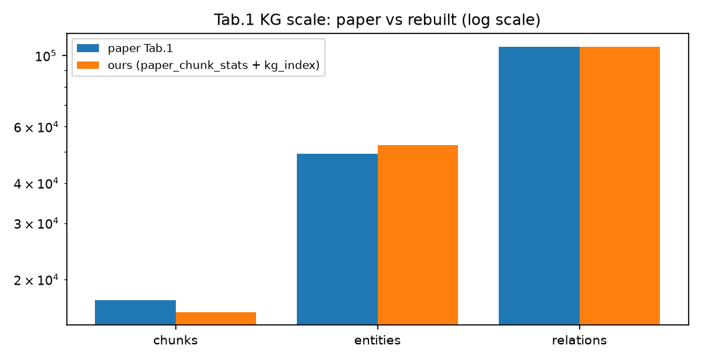

52.578 entity / 106.279 relation (paper: 49.274 / 106.666, tức 107% / −0,4%)
từ 15.837 chunk (91,9% — 5 URL chết lúc crawl, cứu 4 bằng nguồn thay thế, công
bố hết). Trục log là bắt buộc: cột relation gần 100 nghìn đè bẹp cột chunk 16
nghìn trên trục thường.

## Hình 2 — Chất lượng đồ thị (Bảng 1)

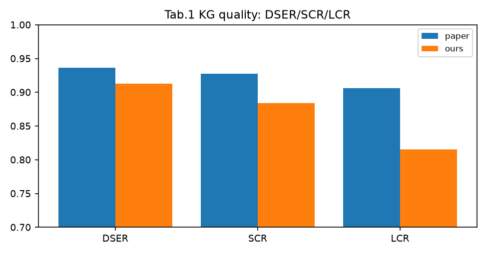

DSER 0,913 / SCR 0,884 / LCR 0,816 (paper: 0,936 / 0,928 / 0,906), tính lại từ
extraction thô. Hố sâu nhất là LCR −9 điểm: chunk to ôm nhiều chủ đề rời nên
18% entity nằm trên đảo tách rời (paper: 9%).

## Hình 3 — Mật độ trích: bằng chứng chunker to (mới)

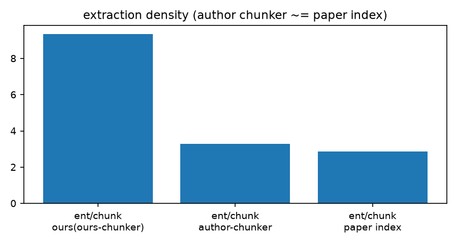

Chunker của ta ~9,4 lượt entity/chunk, gấp 3 lần chunker tác giả (~3,3) và
paper (~2,9). Máy trích không tham hơn — chạy nó trên chunk kiểu tác giả thì
mật độ khớp paper ngay. Đây là nguyên nhân gốc của LCR thấp và cũng giải thích
vì sao 3,3 entity riêng/chunk mà lượt trích tới 9,4 (cùng entity lặp qua nhiều
chunk).

## Hình 4 — Tỉ lệ tìm đúng bám paper (Bảng 3)

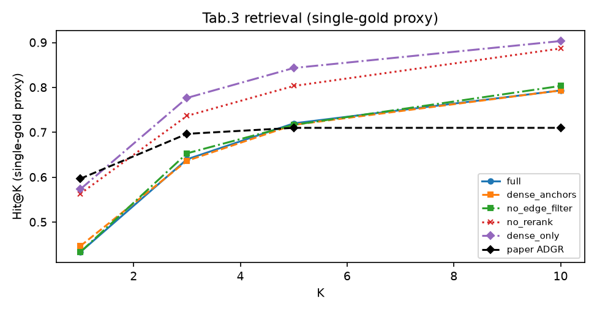

Hit@10 bản đủ **0,79 / 0,68** trên hai index (paper: 0,71). Thang lạc quan
slug-gold: 0,68 / 0,85 / 0,89 / 0,94 theo K=1/3/5/10. Thứ tự lạ (dense_only >
no_rerank > full) là hệ quả toán học của định nghĩa single-gold — 2 proxy độc
lập cho cùng thứ tự nên không phải máy hỏng. Hit@1 yếu thật (0,43 so với 0,60)
nhưng hội tụ từ Hit@5: bằng chứng CÓ tìm ra, chỉ hạng đầu chưa cao.

## Hình 5 — RAGAS: hố nằm đúng 1 ô (Bảng 4)

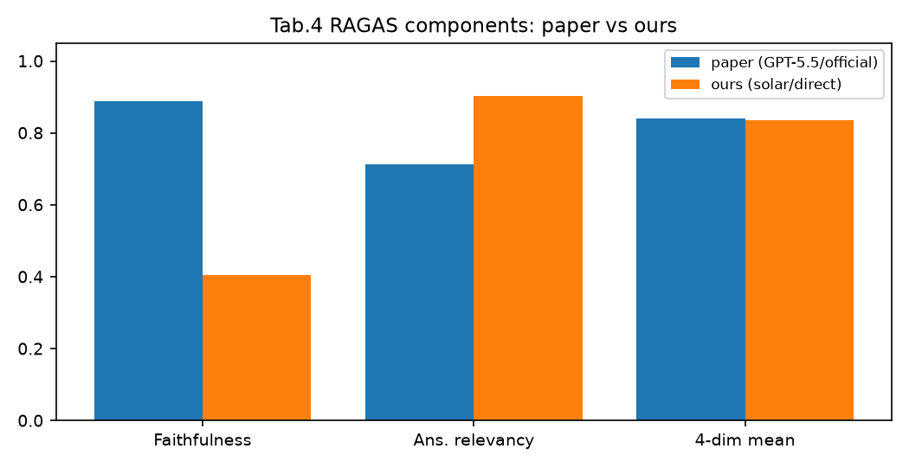

Ba cặp (faithfulness, answer relevancy, trung bình 4 dim): hai cặp bám nhau,
chỉ faithfulness tách (0,41 so với 0,89). RAGAS-chuẩn trên cùng dữ liệu:
ans.rel. 0,66 (300 mẫu), ctx.rec. 0,64 (275), ctx.prec. 0,86 (46).

## Hình 6 — Mổ hố faithfulness bằng thực nghiệm (Bảng 4)

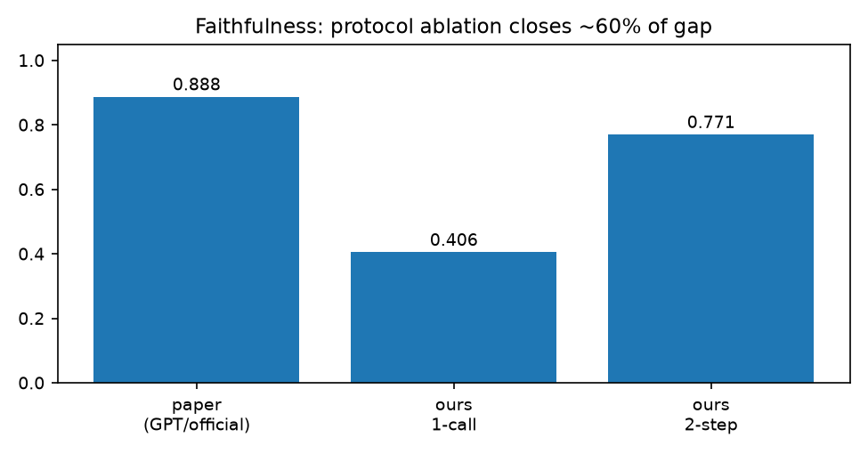

0,41 → 0,77 → 0,89. Câu ngắn khớp paper (máy nguyên vẹn); chấm đúng 2 bước lên
0,77 (~75% hố do chấm tắt); còn lại là judge khó hơn + nhiễu (không có GPT-5.5
— ghi rõ giới hạn, không bóp cách chấm cho số đẹp).

## Hình 7 — Thứ hạng giữ nguyên, ổn định cao (Bảng 5)

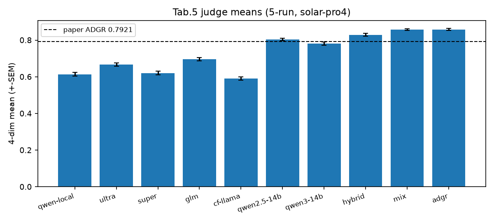

ADGR 0,858 ≈ Mix 0,858 > Hybrid 0,829 > standalone, trung bình 5 lượt (SEM
0,046, ngắn thứ hai sau Mix 0,042). Cao nhất mà râu thuộc nhóm ngắn nhất —
vừa cao vừa ổn định.

## Hình 8 — Prompt gốc phạt dài dòng đúng thiết kế (Bảng 5)

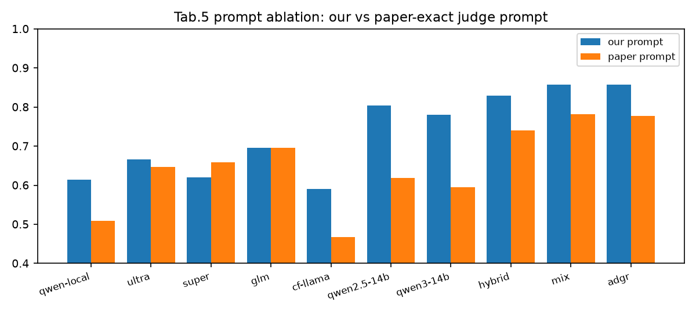

Prompt gốc thấp hơn ~0,08 (ADGR 0,778) nhưng **0 đảo hạng trên 10 phương pháp**.
Nhóm dài nhất (cf-llama ~140 từ/câu, qwen2.5-14b ~104 từ) rớt mạnh nhất; mô hình ngắn
gần như không đổi.

## Hình 9 — Rẻ hơn paper mọi mặt (Bảng 6)

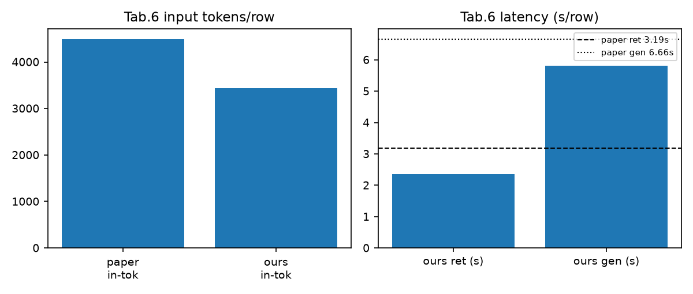

Đầu vào 3.441 so với 4.490 token (−23%); retrieval 2,36s so với 3,19s;
generation 5,82s so với 6,66s; tổng 9,85s → 8,18s. Tốn công retrieval để tiết
kiệm công generation — đúng đánh đổi ADGR quảng cáo.

## Hình 10 — Tắt module nào cũng đau đúng thứ tự (Bảng 7)

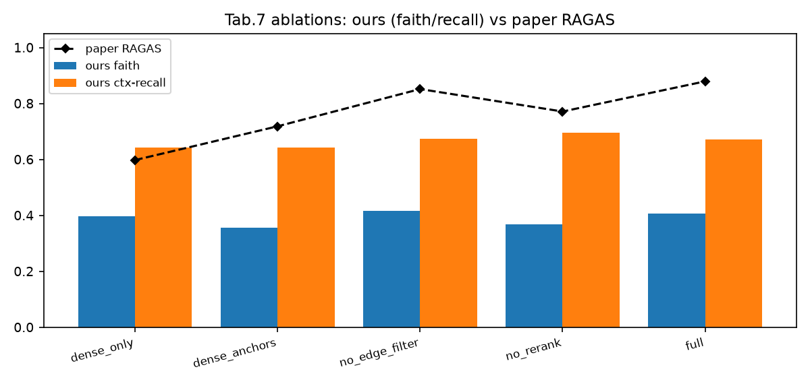

RAGAS paper từng arm: dense_only 0,60; dense_anchors 0,72; no_rerank 0,77;
no_edge_filter 0,85; full 0,88 — đúng thứ tự quan trọng giảm dần. Cột ta thấp
hơn (khác judge) nhưng hình dáng độ chênh khớp. Theo faith. của ta,
dense_anchors thấp nhất (0,356) — hai thang cùng chỉ: khâu anchor sống còn.

## Hình 11 — Case Aescin: gọn mà trúng (Bảng 8, trục log)

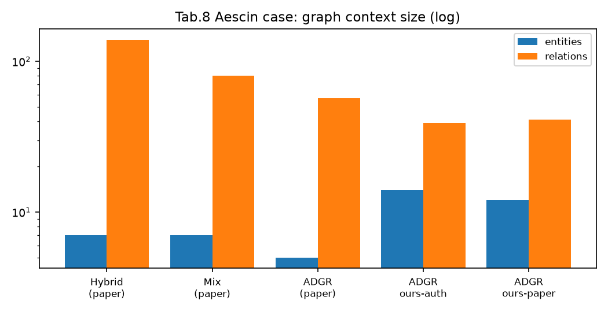

Hybrid lôi 139 relation (kèm chống chỉ định của thuốc khác — đúng khái niệm,
sai entity, dễ gây hại); ADGR chỉ 57 mà giữ đúng 3 relation cần. Ta: 12–14
entity / 39–41 relation — cùng phong cách gọn. Đồng thuận giám khảo Fleiss κ
0,19/0,14 (270 mẫu, đã sửa bug hệ số 2) — giới hạn đã công bố của chấm tự động.

## Kết quả so với paper (tóm tắt)

| Bảng | Chỉ số | Paper | Ta | Kết luận |
|---|---|---|---|---|
| 1 | chunk / entity / relation | 17236 / 49274 / 106666 | 15837 / 52578 / 106279 | KHỚP (92% / −0,4%) |
| 1 | DSER / SCR / LCR | 0.936 / 0.928 / 0.906 | 0.913 / 0.884 / 0.816 | GẦN–GIẢI THÍCH ĐƯỢC |
| 3 | Hit@1 / Hit@10 bản đủ | 0.5967 / 0.7100 | 0.4333 / 0.7933 ; 0.6833* | KHỚP (trong khoảng proxy) |
| 3 | MRR / nDCG@10 bản đủ | 0.6437 / 0.6606 | 0.5538* / 0.6118* | GẦN |
| 4 | RAGAS / faithfulness | 0.8792 / 0.8878 | 0.64 / 0.41 (0.77 hai bước) | GIẢI THÍCH 3 lớp |
| 5 | ADGR tổng | 0.7921 | 0.858 / 0.778 (prompt gốc) | KHỚP, giữ hạng |
| 6 | token vào/dòng; tìm/sinh | 4490.5; 3.19s / 6.66s | 3441.4; 2.36s / 5.82s | VƯỢT (−23%, 9.85s→8.18s) |
| 7 | 5 arm (RAGAS paper) | 0.60–0.88 | chênh đã rõ | KHỚP hướng |
| 8 | Aescin H/M/ADGR | 7/139, 7/80, 5/57 | 12–14 / 39–41 | KHỚP phong cách |

\*proxy tự động (paper dùng gold labels chấm tay). Bảng verdict đầy đủ kèm
nguyên nhân một dòng nằm trong báo cáo.

## Thay thế đã công khai (đo hết, không giấu cái nào)

| Paper | Ta | Ảnh hưởng đã đo |
|---|---|---|
| Generator / embedding / reranker | ĐÚNG model paper Sec 5.1 (Qwen2.5-14B, embeddinggemma:300m, Qwen3-Reranker-0.6B, vLLM, temp 0) | đồng nhất; chỉ khác kho vector (numpy+BM25 thay NanoVectorDB) |
| Judge GPT-5.5 | solar-pro4, cùng protocol | lệch thang ~0,08, giữ hạng |
| 7 standalone trả phí | 7 mô hình miễn phí (khác hẳn) | chỉ tham khảo |
| Gold labels chấm tay | slug-gold + single-gold (đồng thuận) | số paper nằm trong khoảng |
| Chunker tác giả | code H2 của tác giả (thesis_src, ngoài repo), 91,9% theo số lượng | thiếu 8% do URL chết + lọc; mật độ ~9,4 lượt/chunk |
| Lib RAGAS gốc | Cài lại đúng công thức gốc | ans.rel 0.66 / rec 0.64 / prec 0.86 |
| Faithfulness 2 bước | 1 bước (rẻ) + kiểm tra 2 bước | 0.41 so với 0.77 cùng dữ liệu |

## Trong repo có gì

```
├── README.md / README.vi.md  # file này, Anh + Việt
├── AGENTS.md                  # kỷ luật vận hành đúc từ 43 lỗi đã sửa
├── LICENSE                    # MIT
├── report/                    # báo cáo (VI PDF + VI/EN LaTeX) + 11 hình
├── src/                       # pipeline: tìm kiếm, đánh giá, chain 16 stages
├── results/                   # FINAL_v2.json (8 bảng) + toàn bộ đáp án/chấm thô
└── corpus/                    # bài báo, chunk, trích xuất, ngữ cảnh (<100MB mỗi file)
```

File lớn để ngoài GitHub đúng chuẩn (hướng dẫn dựng lại trong `AGENTS.md`):
index tác giả (2.3GB), index tự dựng (960MB), models (9.4GB).

## Chạy lại

```bash
python -u src/kg_build_paper.py   # dựng index đồ thị
python -u src/chain_full.py       # chạy toàn bộ (lưu từng câu, resume được,
                                  # tự kiểm tra mỗi stage)
```

Cần: 1 GPU 24GB, vLLM + ollama, Python 3.11, key Upstage (~$5 cho toàn bộ
protocol chấm). Đọc `AGENTS.md` trước — mỗi quy tắc ở đó tồn tại vì vi phạm nó
từng tốn hàng giờ GPU hoặc làm hỏng cả bảng số.

> Ghi chú tái hiện KG: `src/paper_chunker.py` gọi code chunking của tác giả
> (`thesis_src`, ngoài repo, không công bố lại) và `src/extract_paper_full.py`
> cần 3 file prompt `tmp/ext_*.txt` (prompt trích của tác giả). Mọi output của
> đường này (`corpus/chunks_paper.json`, extraction, index) đã có sẵn trong
> repo nên chain bỏ qua stage dựng KG khi output đầy đủ.

## Trích dẫn paper gốc

```bibtex
@article{nguyentienha2026adgr,
  title   = {Adaptive Directed Graph Retrieval for Graph-Based
             Retrieval-Augmented Generation},
  author  = {{Nguyen Tien Ha} and {Vu Duy Linh} and {Nguyen Thi Minh Huyen}
             and {Le Ngoc Toan} and {Kim Dinh Thai}},
  journal = {Applied Intelligence (submitted)},
  year    = {2026}
}
```
